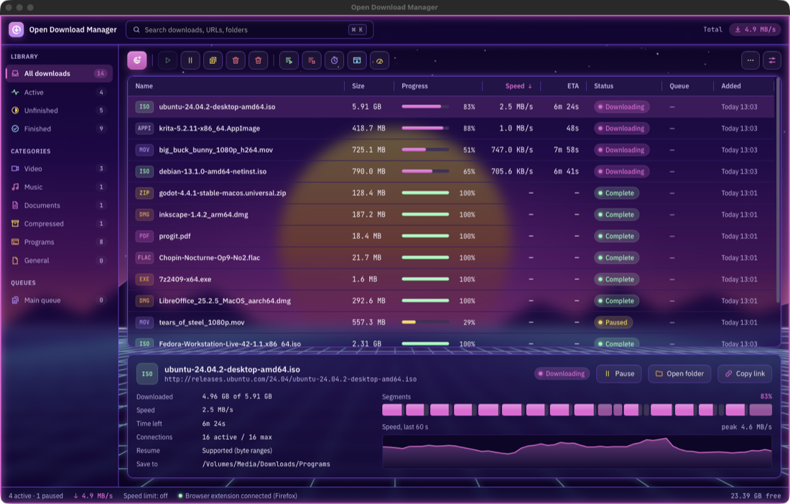
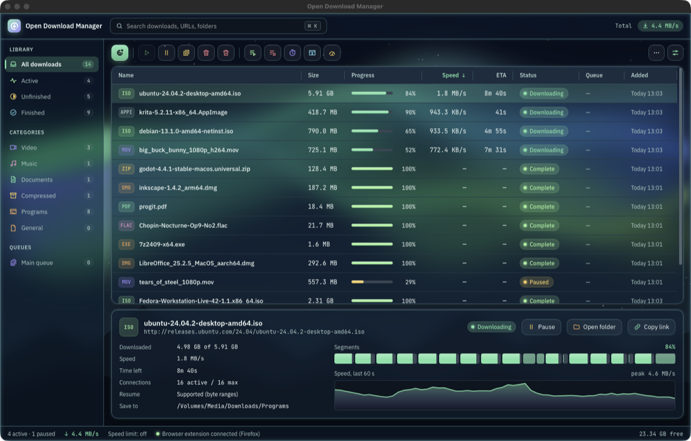
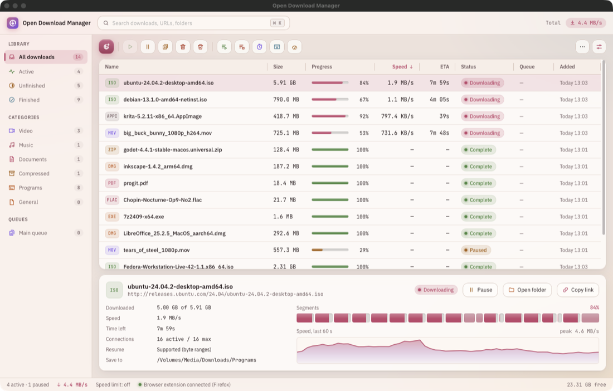
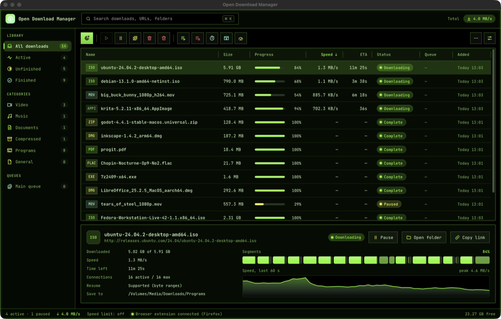

# Themes

Color profiles for Open Download Manager. Each `.odmtheme` file is one profile with everything it needs inside it, pictures included.

## Use one

1. Download a file below.
2. In the app, open the Theme studio (More menu, or Settings → Appearance → Theme studio).
3. Press **Import…** and pick the file. Every open window shows the theme straight away.
4. Press **Save & use** to keep it.

To go back, pick **Default** in the Theme studio, or choose *Use the default theme* in the tray menu.

Themes work in the app, not in the native-toolkit builds (the files with `-native` in their names), which have the dark and light themes only.

## The themes

### Synthwave

Purple and magenta with neon outlines and see-through panels, over a sunset and a grid.

[Download synthwave.odmtheme](https://github.com/zbreilly/open-download-manager/raw/main/themes/synthwave.odmtheme)

### Aurora

Deep teal with green accents and a soft glow, over northern lights.

[Download aurora.odmtheme](https://github.com/zbreilly/open-download-manager/raw/main/themes/aurora.odmtheme)

### Sakura

A light theme in cream and rose, with rounder corners.

[Download sakura.odmtheme](https://github.com/zbreilly/open-download-manager/raw/main/themes/sakura.odmtheme)

### Terminal

Green on black with square corners, and everything set in JetBrains Mono.

[Download terminal.odmtheme](https://github.com/zbreilly/open-download-manager/raw/main/themes/terminal.odmtheme)

## Make your own

Start from any profile in the Theme studio, change what you like, and press **Export…** to save it as a `.odmtheme` file you can share. The background pictures in Synthwave and Aurora were drawn for this project.
